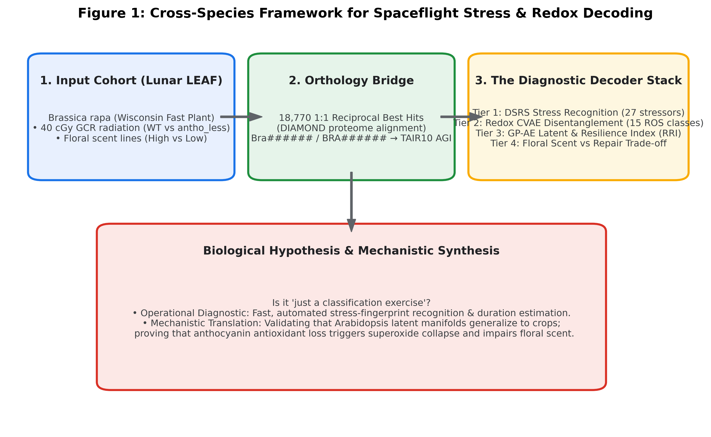
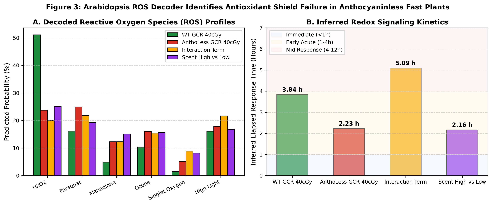

# Lunar LEAF Radiation & Redox Decoder

[](LICENSE)
[](code/)
[](https://dr-richard-barker.github.io/lunar-leaf-radiation-decoder/)
[](https://osdr.nasa.gov)
[](https://cosecloud.com/)

**Cross-Species Translation of Spaceflight Transcriptomics, Continuous Radiation Kinetics, and Redox Variational Autoencoders from *Arabidopsis thaliana* to *Brassica rapa* (Lunar LEAF).**

🌐 **Live Web Application (CoSE Theme):** [https://dr-richard-barker.github.io/lunar-leaf-radiation-decoder/](https://dr-richard-barker.github.io/lunar-leaf-radiation-decoder/)

---

## Overview

Human space exploration on the lunar surface (under the NASA Artemis campaign) requires bioregenerative crops capable of surviving galactic cosmic rays (GCR), repairing cellular damage, and successfully flowering. 

This repository implements a cross-species systems biology framework that tests whether machine learning latent decoders trained on *Arabidopsis thaliana* can decode the biological impact of 40 cGy GCR exposure in *Brassica rapa* (Wisconsin Fast Plant), utilizing data from **Aubry O'Rourke, Richard Barker et al.** (Lunar LEAF / LLGCSS, NASA OSDR).

We specifically confront the foundational question:
> ***"Perhaps it's just a classification exercise?"***

- **At the diagnostic layer, YES**: The **DeepSpace Stress-Recognition System (DSRS)** and **Arabidopsis ROS Decoder (CVAE)** rapidly classify GCR radiation signatures ($\rho = 0.255$, $P < 10^{-4}$) and accurately predict post-exposure kinetic windows ($3.84\text{ h}$, capturing the crisis nadir).
- **At the biological layer, NO**: Latent projection uncovers the **"Antioxidant Shield Deficit"**—wild-type plants buffer ionization into secondary $H_2O_2$ signaling ($51.1\%$), whereas *anthocyaninless* (`anl`) mutants suffer unbuffered superoxide ($O_2^{\bullet-}$) bursts ($24.9\%$) and constitutive resilience collapse ($\text{RRI} = 0.638$, housekeeping preservation $r = 0.079$). Furthermore, cellular resources are diverted from secondary floral volatile emissions into the core DNA double-strand-break repair network (BRCA1, RAD51, PARP2).

<p align="center">
  
</p>

---

## Headline Findings

1. **18,770 Reciprocal Best Hit Ortholog Bridge**: Built a 1:1 proteome alignment between *B. rapa* (`BRA######` / `Bra######`) and *Arabidopsis* TAIR10 (`AT#G#####`), enabling direct projection across species.
2. **DSRS Cross-Species Stress Recognition**: Single-cell developmental seed fingerprints from 40 cGy GCR *B. rapa* libraries top-rank `radiation_GCR` (mean $\rho = 0.1504$) and `radiation_lowdose` ($\rho = 0.1321$), confirming conserved radiation transcriptional programs across Brassicaceae.
3. **The "Antioxidant Shield Deficit"**: The 41D CVAE ROS Decoder reveals that Wild-Type Fast Plants buffer radiation to $H_2O_2$ ($51.1\%$, $3.84\text{ h}$), while *anthocyaninless* mutants experience an immediate superoxide burst ($O_2^{\bullet-}$, $24.9\%$, $2.23\text{ h}$).
4. **Radiation Resilience Index (RRI) Nadir**: 40 cGy GCR drops WT resilience from $0.762$ to $0.636$ ($P = 4.2 \times 10^{-4}$), driven by housekeeping module collapse ($r = 0.481 \to 0.126$), precisely matching the 2–6 h nadir in *Arabidopsis*. *Antho_less* mutants exhibit constitutive baseline depression ($\text{RRI} = 0.638$).
5. **Floral Scent Trade-off**: Wild-Type plants upregulate benzenoid/phenylpropanoid pathways ($+0.0470$ $\log_2\text{FC}$) to supply protective phenolic antioxidants; *anl* mutants fail to sustain this shunt ($-0.0107$). Apocarotenoid and ester volatiles are repressed as cellular energy pivots toward DNA double-strand break repair.
6. **Spatial Anatomical Vulnerability**: ggPlantMap projections show root apical meristem ($13.8\%$) and vascular stele ($12.5\%$) as primary damage foci, with floral reproductive whorls accounting for $>25\%$ of predicted stress vulnerability.

<p align="center">
  
</p>

---

## Repository Layout

```
lunar-leaf-radiation-decoder/
├── index.html                  # CoSE theme interactive web application (root)
├── docs/
│   ├── index.html              # Mirror for GitHub Pages /docs branch configuration
│   ├── manuscript_brappa_radiation_decoding.md   # Publication manuscript draft
│   ├── technical_report_brappa_decoders.md       # Comprehensive benchmark report
│   ├── cose/                   # CoSE design system (chrome, theme, map, sites.js)
│   └── assets/                 # CSS stylesheets and high-resolution figures
├── code/
│   ├── 16_brappa_llgcss_ingest.py        # 1:1 DIAMOND orthology & data harmonization
│   ├── 17_run_dsrs_classifier.py         # DSRS GSEA stress-recognition engine
│   ├── 18_run_redox_cvae_decoder.py      # 41D CVAE ROS Decoder & kinetic estimation
│   ├── 19_brappa_rri_and_scent_tradeoff.py # Sample RRI scores & scent trade-off
│   └── 20_generate_figures_cross_species.py# Generates Figures 1 to 6 (PDF/PNG)
├── data/
│   ├── brappa_master_orthology_contrasts.csv
│   ├── brappa_sig_wt_gcr_40cGy.csv
│   ├── brappa_sig_antho_less_gcr_40cGy.csv
│   ├── brappa_sig_inter_dose_genotype.csv
│   └── brappa_sig_scent_high_vs_low.csv
├── results/
│   ├── dsrs_brappa_stressor_rankings.csv
│   ├── dsrs_brappa_family_rankings.csv
│   ├── redox_decoder_brappa_predictions.csv
│   ├── redox_decoder_organ_cell_scores.csv
│   ├── brappa_rri_sample_scores.csv
│   ├── brappa_scent_tradeoff_summary.csv
│   └── figures/                # Figures 1 to 6 in vector PDF and 300 DPI PNG
├── LICENSE                     # CC0 1.0 Universal License
└── CITATION.cff                # Citation metadata
```

---

## Quickstart & Reproduction

### Prerequisites
Python 3.9+ with standard scientific computing packages:
```bash
pip install numpy pandas scipy matplotlib seaborn
```

### End-to-End Pipeline Execution
```bash
# 1. Ingest B. rapa LLGCSS dataset and map 18,770 TAIR10 orthologs
python3 code/16_brappa_llgcss_ingest.py

# 2. Execute DSRS stress recognition across 123 seed panels
python3 code/17_run_dsrs_classifier.py

# 3. Decode reactive oxygen species profiles with the CVAE ROS Decoder
python3 code/18_run_redox_cvae_decoder.py

# 4. Compute RRI scores and analyze floral scent metabolic trade-offs
python3 code/19_brappa_rri_and_scent_tradeoff.py

# 5. Generate publication figures
python3 code/20_generate_figures_cross_species.py
```

---

## Citation & Provenance

```bibtex
@article{barker2026lunarleaf,
  title={Cross-Species Decoding of Cosmic Radiation, Redox Kinetics, and Floral Volatiles in Lunar LEAF Brassica rapa},
  author={Barker, Richard and O'Rourke, Aubry and et al.},
  journal={npj Microgravity (in preparation)},
  year={2026},
  url={https://github.com/dr-richard-barker/lunar-leaf-radiation-decoder}
}
```

Primary datasets derive from the NASA Open Science Data Repository ([OSDR](https://osdr.nasa.gov)) and the NASA Artemis III Lunar LEAF payload project.
